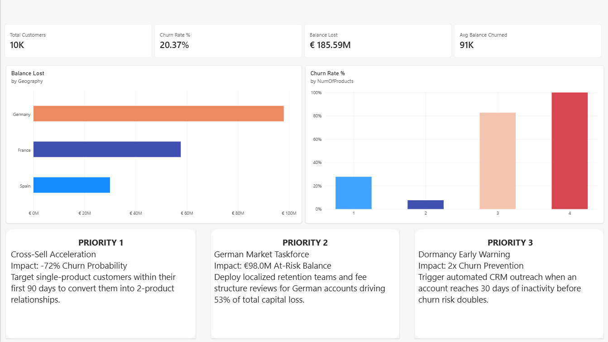
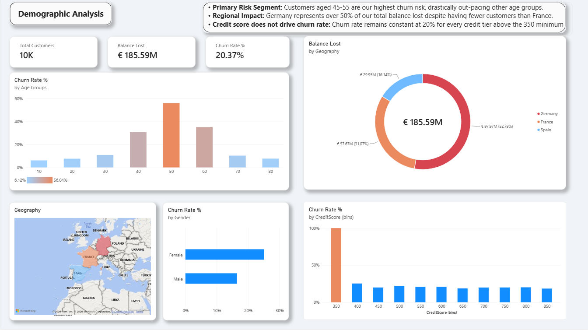
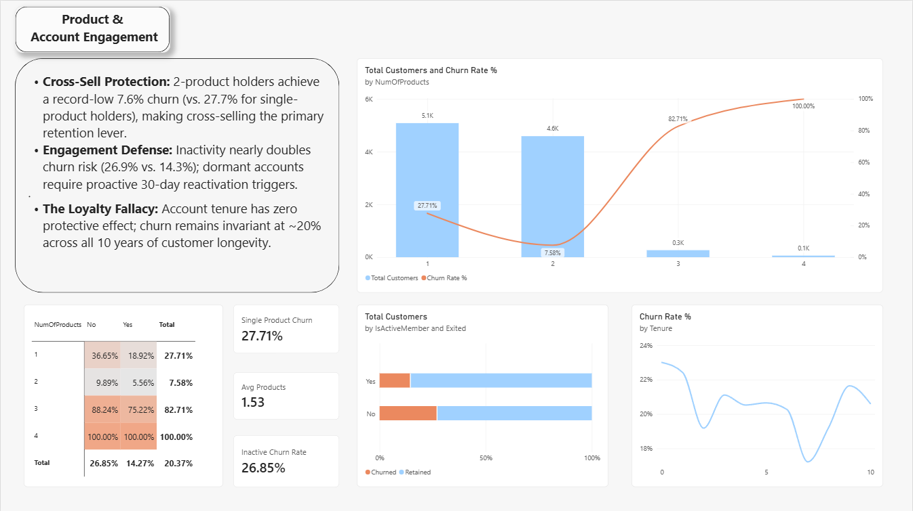

# Bank Customer Churn & Capital Risk Analysis

An interactive 3-page Power BI business intelligence report diagnosing attrition patterns and balance loss across 10,000 retail banking customers.

---

## Executive Summary

### Key Metrics
* **Total Customer Base:** 10,000 accounts
* **Overall Churn Rate:** 20.37% (2,037 customers lost)
* **Total Capital at Risk:** €185.59M in lost customer balance
* **Average Balance of Churned Accounts:** €91,000

---

## Detailed Analyses

### 1. Demographic Risk Analysis

* **Regional Risk Concentration:** Germany represents **52.79% (€97.97M)** of total balance lost, despite having fewer total accounts than France.
* **Age Cohort Vulnerability:** Churn spikes significantly in the 45 to 55 age bracket, reaching over 50% attrition compared to under 10% in younger cohorts.
* **Credit Score Invariance:** Credit scores do not correlate with attrition. Churn remains flat at ~20% across every credit tier above 350.

---

### 2. Product Holding & Engagement Analysis

* **Cross-Sell Protection:** Customers holding 2 products exhibit a low 7.58% churn rate, compared to 27.71% for single-product holders.
* **Inactivity Risk:** Account inactivity nearly doubles attrition risk (26.85% for inactive members vs. 14.27% for active members).
* **The Loyalty Fallacy:** Account tenure has zero protective effect; churn remains invariant at ~20% across all 10 tenure years.

---

## Strategic Recommendations

1. **Cross-Sell Acceleration (Priority 1):** Target single-product accounts within their first 90 days to convert them into 2-product relationships, targeting a 72% relative reduction in churn probability.
2. **German Market Taskforce (Priority 2):** Deploy dedicated retention programs and review local pricing/fee structures in Germany to protect €98.0M in concentrated balance risk.
3. **Automated Dormancy Interventions (Priority 3):** Trigger automated CRM reactivation workflows when customer inactivity reaches 30 days before churn probability doubles.

---

## Technical Implementation
* **Data Modeling:** 1:1 relational schema connecting demographic profiles (`Customer_Info`) with account balances and activity logs (`Account_Info`).
* **DAX Formulas:** Custom measures built for dynamic segmentation, total attrition, and financial exposure calculations (`COUNTROWS`, `CALCULATE`, `DIVIDE`).
* **UI/UX Design:** High-contrast corporate card layout following visual hierarchy and accessibility standards.
